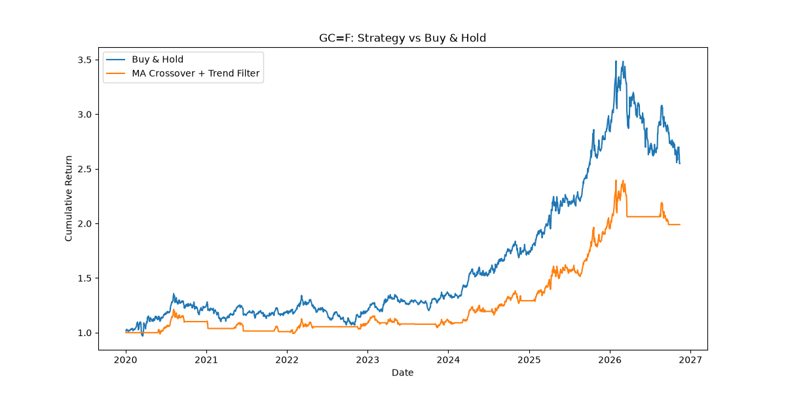

# Gold Futures Trading Strategy & Risk Analysis

## Project Overview

This project explores quantitative trading strategies
in commodity markets using Python and historical gold
futures data.

It implements a trend-following trading strategy based
on moving averages and evaluates its performance against
a buy-and-hold benchmark.

The primary objective is to understand systematic trading
signals, market trends, and risk-adjusted performance.

## Technologies Used

- Python
- Pandas
- NumPy
- Matplotlib
- yfinance

## Trading Strategy

The strategy uses three technical indicators:

| Indicator | Purpose |
|-----------|---------|
| 20-day SMA | Short-term market trend |
| 50-day SMA | Medium-term market trend |
| 100-day SMA | Long-term trend filter |

### Trading Rules

**Long Position:**
- 20-day SMA > 50-day SMA
- Gold price > 100-day SMA

**Exit Position:**
- 20-day SMA <= 50-day SMA, or
- Gold price <= 100-day SMA

Trading positions are shifted by one trading day to
reduce look-ahead bias in the historical backtest.

## Backtesting Methodology

1. Download historical gold futures data (`GC=F`).
2. Calculate 20-day, 50-day, and 100-day moving averages.
3. Generate systematic trading signals.
4. Calculate daily strategy returns.
5. Compute cumulative strategy performance.
6. Compare results against buy-and-hold.
7. Evaluate risk-adjusted performance.

## Risk Analysis

The strategy evaluates:

### Sharpe Ratio
Measures historical returns relative to volatility.

### Maximum Drawdown
Measures the largest decline from a previous
portfolio performance peak.

### Cumulative Returns
Compares overall strategy performance with
buy-and-hold.

## Results and Visualization

The project generates a comparison chart showing
the strategy's cumulative performance relative
to the buy-and-hold benchmark.



Performance depends on market conditions,
historical data, and strategy parameters.

## Project Structure

```text
Gold-Futures-Trading-Strategy/
├── gold_strategy.py
├── requirements.txt
├── strategy_vs_benchmark.png
├── README.md
└── .gitignore
```

## Installation

### 1. Clone the repository

```bash
git clone https://github.com/Surajeata/Gold-Futures-Trading-Strategy.git
cd Gold-Futures-Trading-Strategy
```

### 2. Install dependencies

```bash
python -m pip install -r requirements.txt
```

### 3. Run the project

```bash
python gold_strategy.py
```

## Limitations

- Historical results do not guarantee future returns.
- Transaction costs and slippage are not modeled.
- Futures margin and contract rolling are not modeled.
- Moving averages may generate false signals in sideways markets.

## Future Improvements

- Test different moving-average combinations.
- Incorporate transaction costs.
- Introduce stop-loss and position-sizing rules.
- Extend the analysis to crude oil and silver.
- Compare performance across different market regimes.
